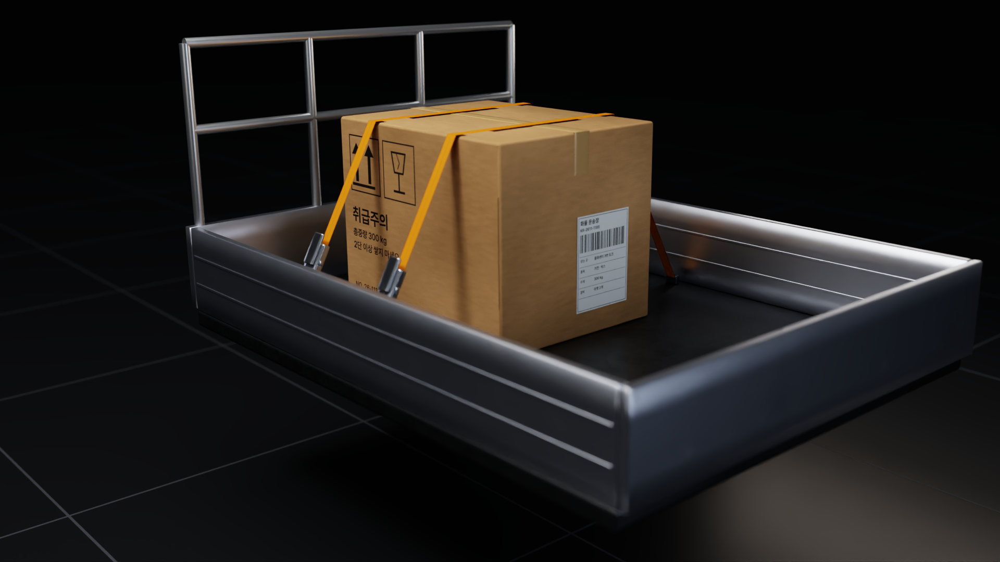
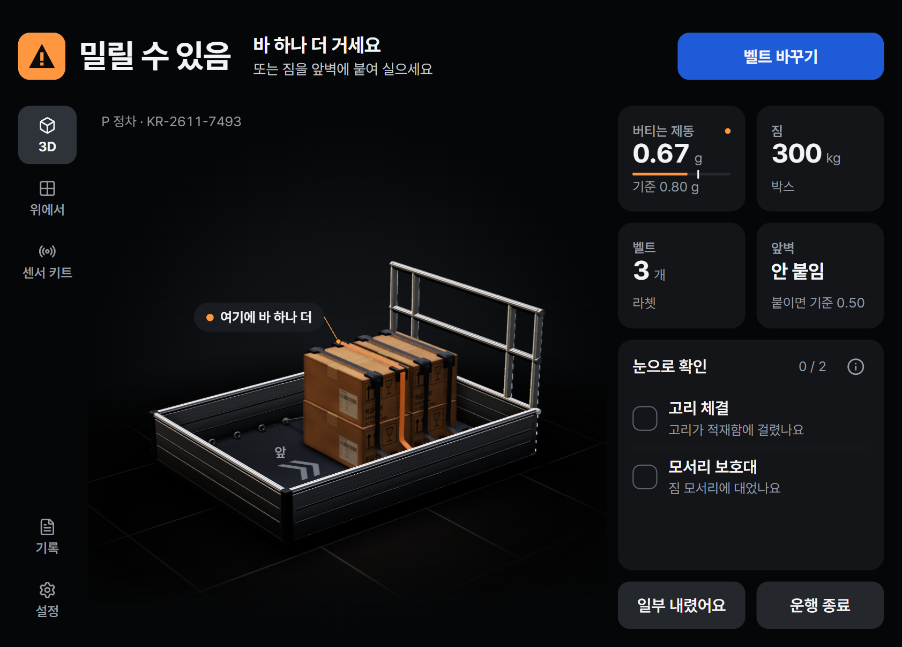
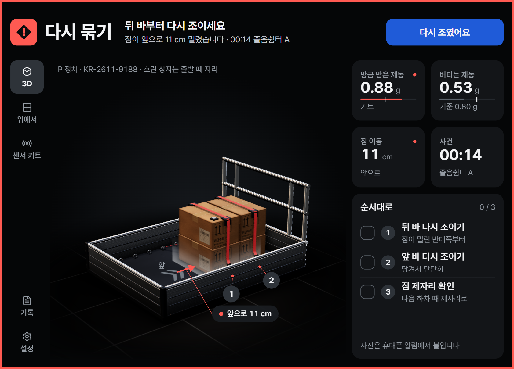
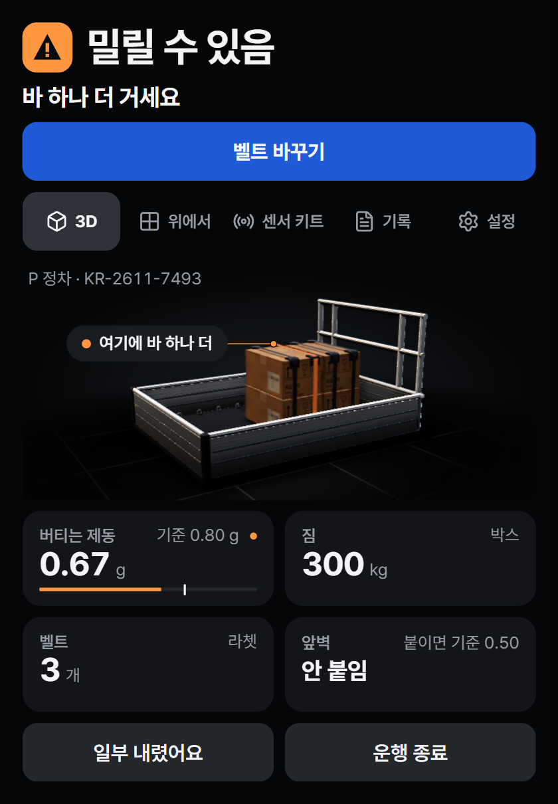
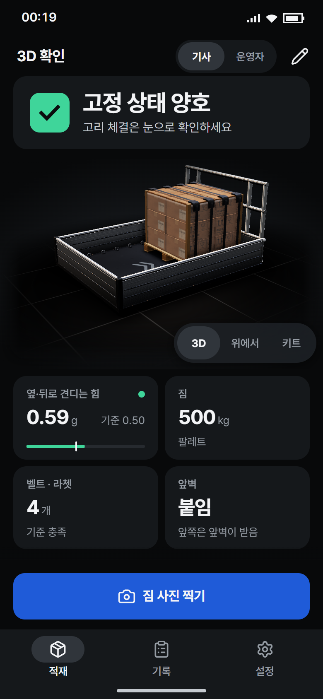
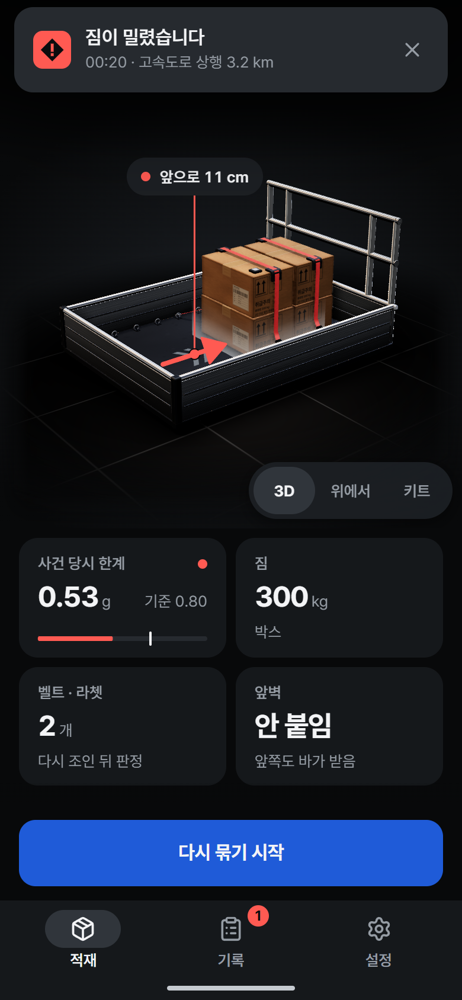
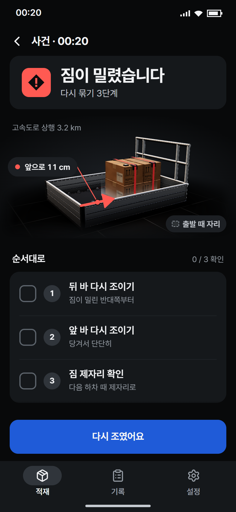
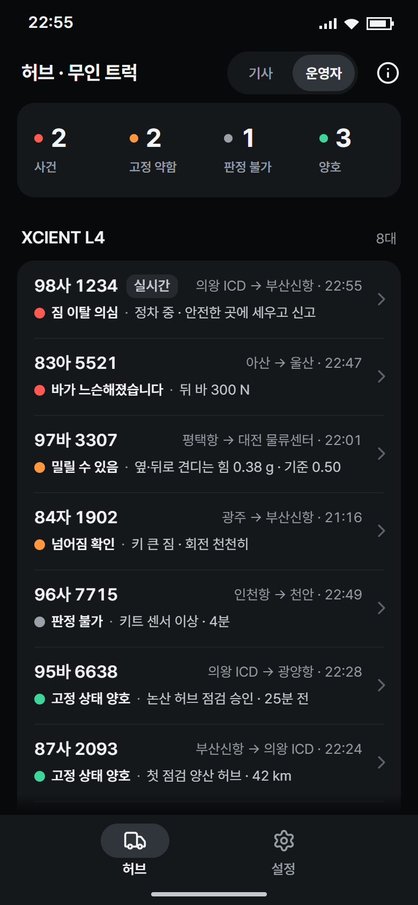
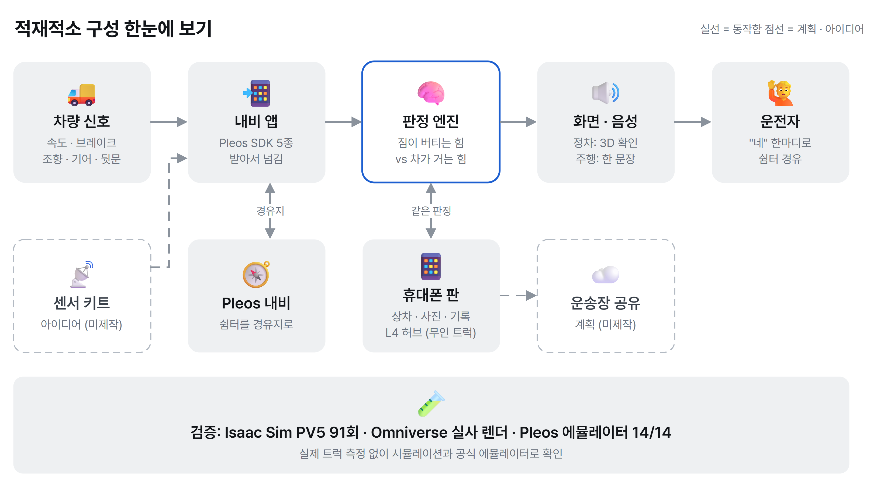

# 적재적소

**짐이 밀리기 전에, 차가 먼저 알려 주는 Pleos Connect 화물 결박 감시 앱**

현대자동차그룹 차량용 앱 개발 공모전(Pleos Connect) 출품작입니다. 대상 차량은 기아 PV5 오픈베드이고, 같은 판정 엔진이 레벨4 무인 트럭 관제 화면까지 이어집니다.



## 한눈에 보기

| | |
|---|---|
| 문제 | 고속도로 낙하물 수거 약 94만 건 (2021~2025년, 한국도로공사). 출발 전 결박 확인은 손으로 당겨 보는 감각에 기댐 |
| 해결 | 출발 전 3D로 결박 상태를 확인하고, 주행 중에는 브레이크 · 조향 · 속도 신호로 짐이 위험해진 순간을 잡아 할 일 하나만 음성으로 안내 |
| 검증 | Isaac Sim PV5 오픈베드 디지털 트윈 91회 주행, 짐이 밀린 32회 모두 "확인 필요"로 판정 |
| 차량 연동 | Pleos SDK 5종 연결, 공식 Pleos Connect 에뮬레이터 자동 주행 시험 14개 항목 통과 |

## 주요 기능

- **정차 중 3D 확인**: 짐 종류 · 무게 · 벨트 수만 고르면 적재함 3D에 바를 더 걸 자리를 표시합니다.
- **주행 중 한 문장 안내**: 화면 조작 없이 필요한 순간에만 음성으로 알립니다. 주행 중 화면은 색 하나와 한 줄입니다.
- **"네" 한마디로 쉼터 경유**: 큰 제동 뒤 "다음 졸음쉼터에서 확인할까요?"에 "네"라고 답하면 내비게이션에 경유지가 들어갑니다.
- **정차 후 다시 묶기**: 기어를 P에 두면 다시 묶을 순서를 3D 번호로 보여 줍니다.
- **운송장 기록 · 휴대폰 판**: 상차 판정, 사건, 조치, 사진을 운송장별로 남기고 휴대폰에서 확인 · 내보냅니다.
- **L4 허브**: 무인 트럭 여러 대의 결박 상태를 운영자가 한 화면에서 봅니다.

## 화면

| 차 화면 (Pleos Connect) | 다시 묶기 | 세로 창 |
|---|---|---|
|  |  |  |

| 휴대폰 3D 확인 | 알림 | 사건 | L4 허브 |
|---|---|---|---|
|  |  |  |  |

영상: [시연 영상](docs/demo.mp4) · [디지털 트윈 급제동](docs/twin_brake.mp4) · [숏폼 (세로 44초)](docs/shorts.mp4)

## 구성



원본은 draw.io 파일입니다: [`app/design/architecture/jaejeok_architecture.drawio`](app/design/architecture/jaejeok_architecture.drawio)

## 판정 방법

- 짐이 버티는 힘: EN 12195-1 결박식에 미끄러지는 중의 마찰(0.8배)을 넣은 **0.8 × μ × (1 + 2 ΣT sin α ÷ mg)**
- 기준: 앞 0.8 g, 옆 · 뒤 0.5 g. 센서 키트가 없을 때는 속도 신호로 구한 제동 · 회전 세기를 1.25배로 키워 비교
- 시험: 판정 엔진 단위 시험 26개

## 폴더

| 폴더 | 내용 |
|---|---|
| `app/web` | React · TypeScript 웹 앱 (판정 엔진, 내비 판, 휴대폰 판, three.js 3D) |
| `app/android` | Kotlin 껍데기 (WebView + Pleos SDK 5종), 내비 · 휴대폰 두 가지 빌드 |
| `app/tools/e2e` | Pleos 에뮬레이터 자동 시험, 화면 캡처 스크립트 |
| `app/design` | 디자인 명세, 구성도 |
| `sim` | Isaac Sim PV5 오픈베드 디지털 트윈 (PhysX 검증, Omniverse 실사 렌더) |
| `docs` | README 그림 · 영상 |

## 실행

웹 (시연 무대):

```bash
cd app/web
npm install
npm run dev        # http://localhost:5173/?app=stage   (차 화면 ?app=nav, 휴대폰 ?app=phone)
```

설치 파일: [`apk/jaejeok-nav-debug.apk`](apk/jaejeok-nav-debug.apk) (차 화면, Pleos Connect) · [`apk/jaejeok-phone-debug.apk`](apk/jaejeok-phone-debug.apk) (휴대폰)

안드로이드 APK 직접 빌드 (JDK 17, Gradle 8.7):

```bash
cd app/web && npm run build
cd ../android && gradle assembleNavDebug assemblePhoneDebug
```

Pleos Connect 에뮬레이터 자동 시험: `app/tools/e2e/pleos-run.sh` (설명은 `app/README_dev.md`)

## 아직 확인하지 못한 것

- 사람 목소리로 한 "네" 인식 (가상 마이크의 합성 음성으로는 확인)
- 실제 경로에서 내비가 보내는 주의 지점 알림 (앱 쪽 처리는 확인)
- 실차에서의 CPU · 메모리 사용량, 앱 마켓 심사

모든 검증은 Isaac Sim 시뮬레이션과 공식 Pleos Connect 에뮬레이터로 했으며, 실제 트럭에서 잰 값은 없습니다.
